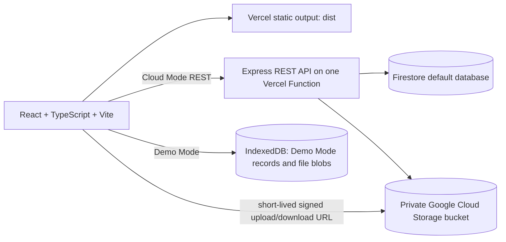
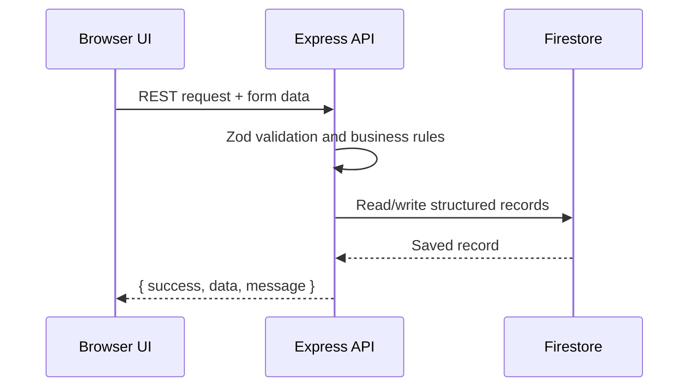
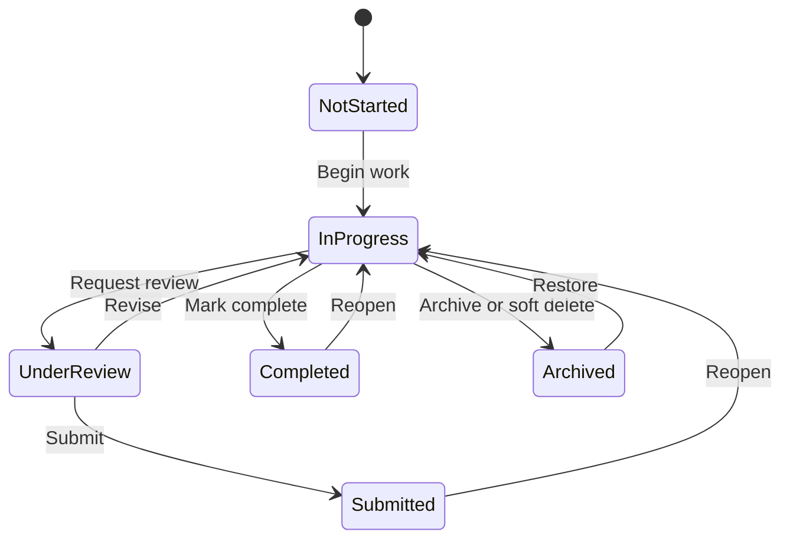
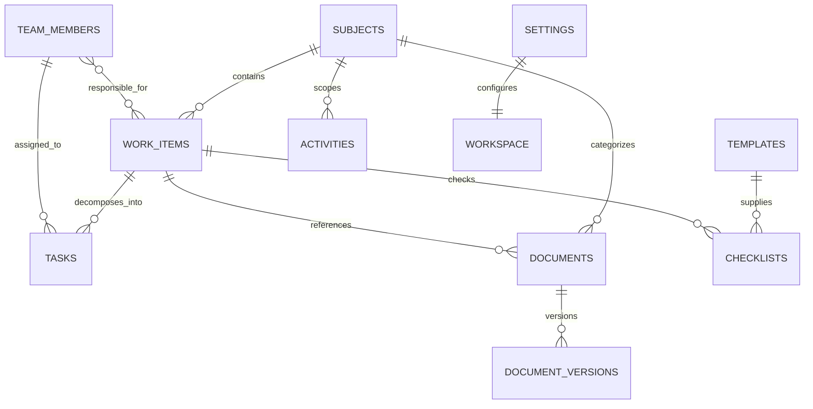

# Sky Vault architecture

## System architecture



## Responsibilities

- **Vercel static output:** serves the Vite frontend and SPA fallback routes.
- **Express API:** validates requests with shared Zod schemas, enforces upload constraints and rate limits, applies business rules, and creates signed URLs. It exports an Express app from `api/index.ts`; Vercel runs it as a serverless Node.js function. There is no production `listen()` call.
- **Firestore:** stores subject, work, task, teammate, document metadata, template, checklist, activity, notification, and setting records, plus pre-action snapshots in `workspaceBackups`. The Admin SDK is server-only. Firestore client rules deny direct client access.
- **Cloud Storage:** stores file bytes in a private bucket. Firestore stores object paths and metadata only. Uploads use the server-generated `pending/uploads/` prefix until completion; cleanup only removes stale, unreferenced objects under that prefix.
- **IndexedDB:** provides persistent browser-local records and files in Demo Mode. Demo files are never represented as GCS objects.

## Data flow



## File upload and download flow

```mermaid
sequenceDiagram
  participant UI as Browser
  participant API as Express API
  participant GCS as Private GCS bucket
  participant DB as Firestore
  UI->>API: filename, MIME, size, signature
  API->>API: Validate allowed file type and size
  API->>DB: Save pending document metadata
  API-->>UI: Short-lived signed PUT URL
  UI->>GCS: Upload bytes directly
  UI->>API: Complete upload
  API->>GCS: Verify object size and signature
  API->>DB: Mark metadata ready; retain previous version
  API-->>UI: Ready document
  UI->>API: Request document download
  API->>DB: Confirm metadata exists
  API-->>UI: Short-lived signed GET URL
  UI->>GCS: Download file bytes
```

## Project management workflow



## Firestore relationships



## API and routing

The API uses `/api/health`, `/api/workspace`, `/api/subjects`, `/api/work-items`, `/api/tasks`, `/api/team-members`, `/api/documents`, `/api/templates`, `/api/checklists`, `/api/activities`, `/api/notifications`, `/api/analytics`, `/api/search`, and `/api/export`/`import`. Backup and recovery add `/api/workspace/backup`, `/api/workspace/backups`, `/api/workspace/restore`, `/api/team-members/:id/restore`, `/api/templates/:id/restore`, and `/api/maintenance/cleanup`. All success responses use `{ success: true, data, message }`; failures use `{ success: false, error: { code, message } }`.

Patch endpoints accept an optional `expectedUpdatedAt`. When present, the service compares it with the stored `updatedAt` and returns `409 CONFLICT` instead of overwriting a newer revision; the field is removed before the patch is applied. Import, workspace clear, and demo reset save a `workspaceBackups` snapshot first. Backup restore also snapshots the current state, then rehydrates structured records; in Cloud Mode it skips document/version metadata because snapshots do not contain file bytes. Maintenance cleanup expires backup documents, marks stale pending documents failed, and deletes stale pending objects that are not referenced by ready documents or versions.

`vercel.json` rewrites API subpaths through `/api/index` and passes the requested route query for Express route normalization. All other paths rewrite to the Vite `index.html`; Vercel serves the static `dist` output independently of Express.
